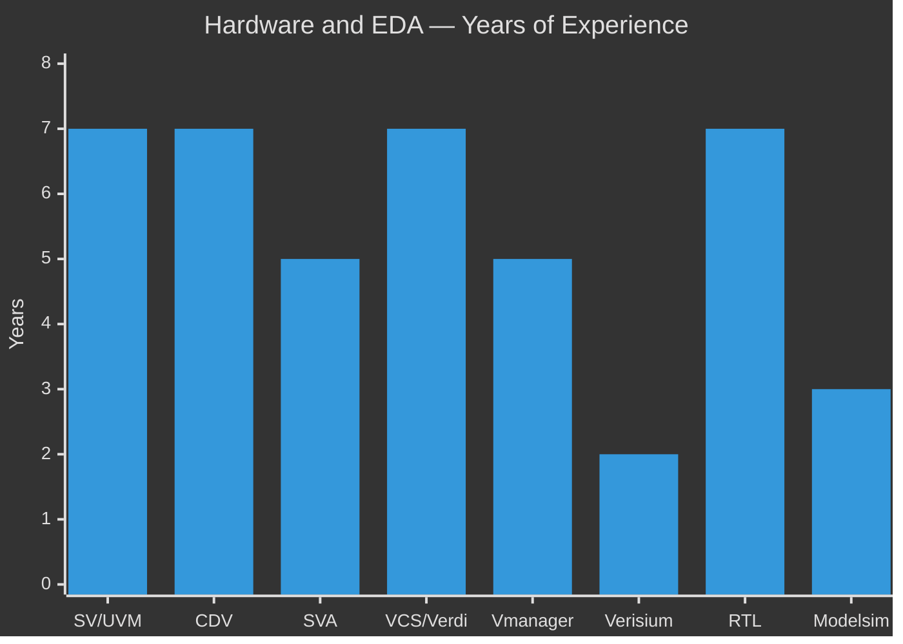
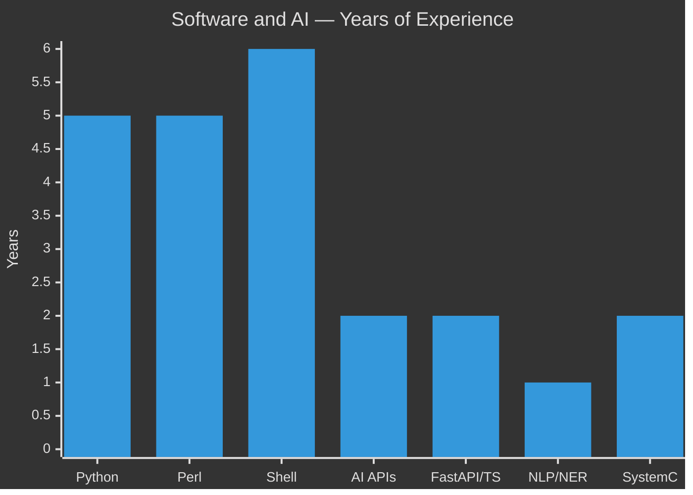
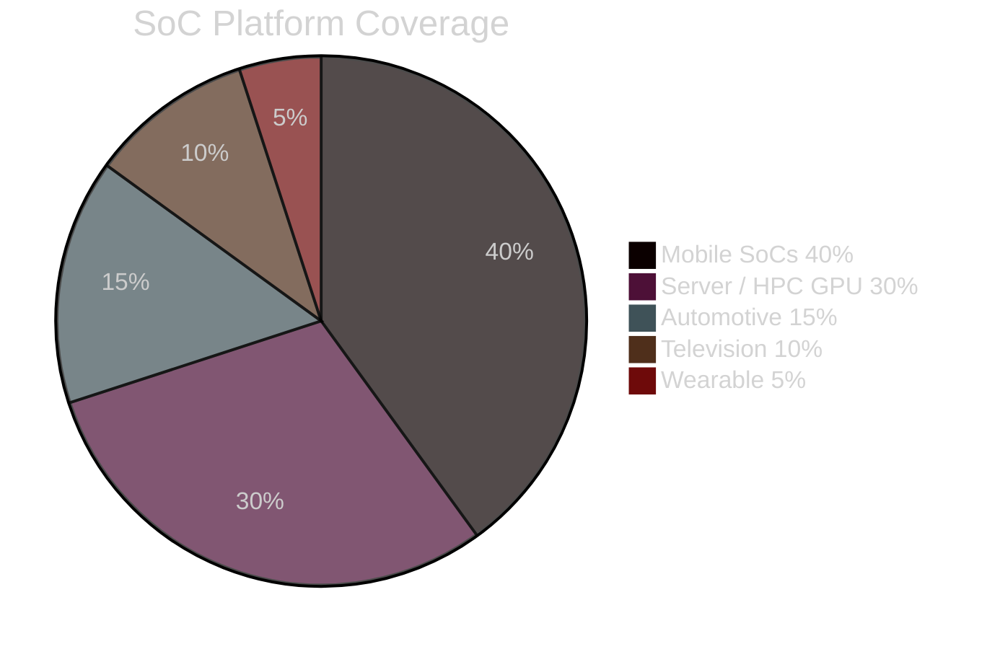
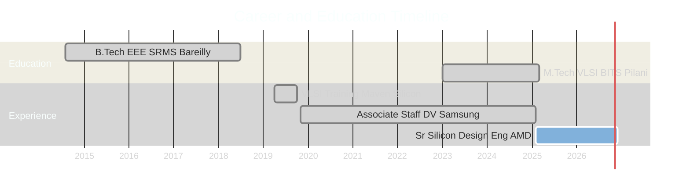

<div align="center">


<h3>Sr. Silicon Design Engineer &nbsp;|&nbsp; GPU & SoC Verification &nbsp;|&nbsp; Agentic AI</h3>


<br/><br/>

[](https://atifafzal.netlify.app/)
[](https://dvmentorship.netlify.app/)
[](https://topmate.io/letslearntechnologies)

[](https://www.linkedin.com/in/themanmakerx/)
[](https://www.youtube.com/@letslearntechnologies)
[](https://www.instagram.com/theman.makerx/)
[](https://www.facebook.com/themanmakerX/)

[](mailto:atifafzal457@gmail.com)
[](https://pypi.org/user/atifafzal786/)

<br/>


</div>

-----

<div align="center"><h3>👤 About Me</h3></div>

Sr. Silicon Design Engineer at **AMD** with **7+ years** of hands-on experience across mobile, automotive, wearable, and server-class GPU SoCs. I bridge hardware verification and agentic AI — building the tooling layer that makes design verification smarter, faster, and more autonomous.

> *7+ years of silicon. Multiple tapeouts. From mobile wearables to server-class GPUs. Now building the AI layer that makes verification smarter.*

💡 **Open to:** Hardware AI tooling collaborations · Verification automation consulting · NLP for EDA research

-----

<div align="center"><h3>📊 GitHub Stats</h3></div>

<div align="center">


</div>

<br/>

<div align="center">


</div>

-----

<div align="center"><h3>🐍 Contribution Snake</h3></div>

<div align="center">

<picture>
  <source media="(prefers-color-scheme: dark)" srcset="https://raw.githubusercontent.com/themanmakerX/themanmakerX/output/github-contribution-grid-snake-dark.svg"/>
  <source media="(prefers-color-scheme: light)" srcset="https://raw.githubusercontent.com/themanmakerX/themanmakerX/output/github-contribution-grid-snake.svg"/>
  
</picture>

</div>

-----

<div align="center"><h3>📊 At a Glance</h3></div>

<div align="center">

<table width="100%">
<tr><th width="6%">&nbsp;</th><th width="30%">Metric</th><th width="64%">Value</th></tr>
<tr><td align="center">🏭</td><td><b>Current Role</b></td><td>Sr. Silicon Design Engineer @ AMD</td></tr>
<tr><td align="center">⏱️</td><td><b>Total Experience</b></td><td>7+ Years in Production Silicon</td></tr>
<tr><td align="center">🔲</td><td><b>SoC Domains</b></td><td>Mobile · Automotive · Wearable · TV · Server HPC</td></tr>
<tr><td align="center">🖥️</td><td><b>GPU Vendors</b></td><td>Arm · AMD · Imagination Technologies</td></tr>
<tr><td align="center">✅</td><td><b>Verification Scenarios</b></td><td>13 SoC-Level Scenario Types</td></tr>
<tr><td align="center">📦</td><td><b>Open Source</b></td><td>3 Published PyPI Packages</td></tr>
<tr><td align="center">🤖</td><td><b>AI Integration</b></td><td>Claude API · OpenAI API · 6 MCP Servers</td></tr>
<tr><td align="center">🔬</td><td><b>Research</b></td><td>NLP/NER for Automated SoC Verification</td></tr>
<tr><td align="center">🎓</td><td><b>Education</b></td><td>M.Tech Microelectronics, BITS Pilani (2025)</td></tr>
<tr><td align="center">📍</td><td><b>Location</b></td><td>Bengaluru, India</td></tr>
</table>

</div>

-----

<div align="center"><h3>🧠 Skill Proficiency</h3></div>





-----

<div align="center"><h3>📈 Domain Experience Distribution</h3></div>



-----

<div align="center"><h3>⏳ Career Timeline</h3></div>



-----

<div align="center"><h3>🏢 Career Journey</h3></div>

<details>
<summary><b>📋 View Full Career Details</b></summary>

<br/>

<div align="center">

<table width="100%">
<tr><th align="center">Period</th><th align="center">Company</th><th align="center">Role</th><th align="left">Scope</th></tr>
<tr><td align="center">Feb 2025 – Present</td><td align="center"><b>AMD</b>, Bengaluru</td><td align="center">Sr. Silicon Design Engineer</td><td align="left">GPU SoC verification · UVM + SystemC · Server & laptop GPU variants · AI-powered debug tooling</td></tr>
<tr><td align="center">Nov 2019 – Feb 2025</td><td align="center"><b>Samsung R&D</b>, Bengaluru</td><td align="center">Associate Staff DV Engineer</td><td align="left">5+ years · GPU block DV for Arm, AMD, Imagination IPs · Mobile · Auto · Wearable · TV SoCs · Perl automation suite</td></tr>
<tr><td align="center">Apr – Oct 2019</td><td align="center"><b>Maven Silicon</b>, Bengaluru</td><td align="center">VLSI Trainee</td><td align="left">Advanced VLSI Design & Verification · UART IP core · Router 1×3 RTL design & verification</td></tr>
</table>

</div>

</details>

-----

<div align="center"><h3>🎓 Education</h3></div>

<details>
<summary><b>📚 View Education Details</b></summary>

<br/>

<div align="center">

<table width="100%">
<tr><th align="left">Degree</th><th align="center">Institution</th><th align="center">Period</th></tr>
<tr><td align="left">M.Tech, Microelectronics & VLSI Design</td><td align="center">BITS Pilani, Rajasthan Campus</td><td align="center">Jan 2023 – Mar 2025</td></tr>
<tr><td align="left">B.Tech — Electrical & Electronics Engineering</td><td align="center">SRMS College of Engineering & Technology, Bareilly</td><td align="center">Aug 2014 – Jul 2018</td></tr>
<tr><td align="left">Advanced VLSI Design & Verification Training</td><td align="center">Maven Silicon, Bengaluru</td><td align="center">Apr – Oct 2019</td></tr>
</table>

</div>

</details>

-----

<div align="center"><h3>🔬 Verification Expertise</h3></div>

<details>
<summary><b>🖥️ GPU Ecosystem — Vendors & SoC Platforms Verified</b></summary>

<br/>

```
GPU IP Vendors Verified
  ├── Arm GPU          →  Mobile SoCs (Samsung)
  ├── AMD GPU          →  Mobile SoCs (Samsung)
  ├── Imagination GPU  →  Television SoCs (Samsung)
  └── AMD GPU          →  Server & Laptop (AMD)

SoC Platform Types
  ├── Mobile SoCs      →  Flagship & mid-range smartphones
  ├── Automotive SoCs  →  Infotainment, ADAS
  ├── Wearable SoCs    →  Smartwatches
  ├── Television SoCs  →  Smart TV platforms
  └── Server / HPC     →  GPU compute & inference

Multimedia IP Experience
  ├── GPU subsystems
  └── Video-Codec IPs
```

</details>

<details>
<summary><b>✅ SoC-Level Verification — 13 Scenario Types</b></summary>

<br/>

<div align="center">

<table width="100%">
<tr><th align="center">#</th><th align="left">Scenario</th><th align="left">Methodology</th></tr>
<tr><td align="center">01</td><td align="left">Register Read / Write</td><td align="left">RAL — UVM Register Abstraction Layer</td></tr>
<tr><td align="center">02</td><td align="left">Connectivity</td><td align="left">Clock · Reset · Interrupt · System Registers</td></tr>
<tr><td align="center">03</td><td align="left">Security Compliance</td><td align="left">Spec-based access permission validation per IP</td></tr>
<tr><td align="center">04</td><td align="left">Core Functional</td><td align="left">Spec-driven scenario definition & execution</td></tr>
<tr><td align="center">05</td><td align="left">Reset Verification</td><td align="left">IP register reset values via reg_def sheets</td></tr>
<tr><td align="center">06</td><td align="left">Interrupt Handling</td><td align="left">Frame completion + IP-specific interrupt flows</td></tr>
<tr><td align="center">07</td><td align="left">Clock Gating</td><td align="left">AMBA Q-Channel (auto) + SFR writes (manual)</td></tr>
<tr><td align="center">08</td><td align="left">Safety — ASIL</td><td align="left">Functional safety compliance for safety-critical IPs</td></tr>
<tr><td align="center">09</td><td align="left">DVFS</td><td align="left">Frequency scaling per voltage sequencing spec</td></tr>
<tr><td align="center">10</td><td align="left">Low Power Simulation</td><td align="left">Power-up / down tests per IP voltage domain</td></tr>
<tr><td align="center">11</td><td align="left">Functional Coverage</td><td align="left">Covergroup / Coverpoint definition and closure</td></tr>
<tr><td align="center">12</td><td align="left">Gate-Level Simulation</td><td align="left">Post-synthesis SoC-level gate sim</td></tr>
<tr><td align="center">13</td><td align="left">X-Prop & CDC</td><td align="left">X-propagation and clock domain crossing cleanup</td></tr>
</table>

</div>

</details>

-----

<div align="center"><h3>⚙️ Automation Portfolio</h3></div>

<details>
<summary><b>🤖 At AMD — AI-Powered DV Tooling &nbsp;|&nbsp; Python · OpenAI API · Claude API</b></summary>

<br/>

**🔹 AI-Debug Framework** — OpenAI / Codex integration into DV workflows

- Hybrid CLI + GUI for AI-assisted root-cause analysis, log triage, and test failure diagnosis
- Modular hooks pull context from waveform logs, coverage reports, and simulation outputs
- Batch CLI: failure summarization, hypothesis generation, rerun recommendations
- Secure API key management, rate-limit handling, and offline fallbacks

**🔹 Testcase Monitoring Wizard** — Real-time regression dashboard *(Python · Tkinter)*

- GUI for real-time Pass / Fail / Running categorization from run directories
- One-click access to logs, waveforms, and debug artifacts
- Search, filter, and drill-down for fast triage across multiple projects

**🔹 Disk Monitoring Setup** — Multi-user disk management *(Python · CLI + GPU)*

- Tracks disk utilization across all user directories proactively
- Threshold-based alerts, user-wise categorization, historical usage trends

</details>

<details>
<summary><b>🛠️ At Samsung — Perl Automation Suite &nbsp;|&nbsp; Perl · XLS → SV / VSIF / TXT</b></summary>

<br/>

<div align="center">

<table width="100%">
<tr><th align="left">Tool</th><th align="center">Input</th><th align="center">Output</th><th align="left">Purpose</th></tr>
<tr><td align="left"><b>Test Case Generator</b></td><td align="center">Hardware Description Spec <code>.xls</code></td><td align="center"><code>.sv</code> class files</td><td align="left">Auto-generate UVM test classes from spec</td></tr>
<tr><td align="left"><b>Vsif File Generator</b></td><td align="center">Attribute Sheet <code>.xls</code></td><td align="center"><code>.vsif</code></td><td align="left">Cadence Vmanager-compatible coverage config</td></tr>
<tr><td align="left"><b>Coverage Coder</b></td><td align="center">Covergroup / Coverpoint <code>.xls</code></td><td align="center"><code>.sv</code> coverage class</td><td align="left">Functional coverage automation</td></tr>
<tr><td align="left"><b>Regression Status Monitor</b></td><td align="center">Dump directory</td><td align="center"><code>.txt</code> report</td><td align="left">Pass / Fail / In-Progress / Rerun counts</td></tr>
</table>

</div>

</details>

-----

<div align="center"><h3>🧠 ML & NLP Research</h3></div>

<details>
<summary><b>📄 Enhancing SoC Verification Using NLP — BITS Pilani M.Tech Project (May – Nov 2024)</b></summary>

<br/>

```
Project  : Enhancing SoC Verification Using Natural Language Processing
Duration : May 2024 – November 2024
Institute: BITS Pilani, Rajasthan Campus
```

**What was built:**

- Trained a **Named Entity Recognition (NER)** model on SoC design documents and integration specs
- Model identifies and labels entities in spec text, detects formatting patterns across sections
- Establishes inter-label dependencies to **predict verification scenarios automatically**
- Self-learning: prediction accuracy improves as the model fine-tunes on new simulation results

<br/>

<div align="center">

<table width="100%">
<tr><th align="left">Area</th><th align="left">Techniques</th></tr>
<tr><td align="left">Learning Paradigms</td><td align="left">Supervised · Unsupervised · Semi-Supervised · Reinforcement Learning</td></tr>
<tr><td align="left">NLP Pipeline</td><td align="left">Dataset creation → Training → Optimization → Fine-tuning</td></tr>
<tr><td align="left">Application</td><td align="left">Automated extraction of verification scenarios from unstructured spec text</td></tr>
</table>

</div>

</details>

-----

<div align="center"><h3>📦 Open Source Projects</h3></div>

<details>
<summary><b>🚀 View All Projects & PyPI Packages</b></summary>

<br/>

<div align="center">

<a href="https://github.com/themanmakerX/Agentic-AI"></a>
<a href="https://github.com/themanmakerX/UVM-Testbench-Generator"></a>
<a href="https://github.com/themanmakerX/Grepper-Utility"></a>

<br/><br/>

<table width="100%">
<tr><th align="left">Project</th><th align="left">Stack</th><th align="center">PyPI</th><th align="left">Description</th></tr>
<tr><td align="left"><b><a href="https://github.com/themanmakerX/Agentic-AI">Agentic-AI</a></b></td><td align="left">Python · Shell · JS · TS · FastMCP</td><td align="center">—</td><td align="left">Modular AI coding agent framework — reusable skills, MCP servers, knowledge graphs, multi-agent orchestration</td></tr>
<tr><td align="left"><b><a href="https://github.com/themanmakerX/UVM-Testbench-Generator">UVM-Testbench-Generator</a></b></td><td align="left">Python · Tkinter · SV templates</td><td align="center"><a href="https://pypi.org/project/uvm-testbench-generator/"></a> </td><td align="left">GUI scaffold: DUT import → full UVM environment in one workflow</td></tr>
<tr><td align="left"><b><a href="https://github.com/themanmakerX/Grepper-Utility">Grepper-Utility</a></b></td><td align="left">Python · Regex · ANSI</td><td align="center"><a href="https://pypi.org/project/grepper/"></a> </td><td align="left">Fast recursive file-search CLI with regex, ignore patterns, colorized output</td></tr>
</table>

</div>

</details>

-----

<div align="center"><h3>🧰 Technical Arsenal</h3></div>

<details>
<summary><b>💻 Hardware Languages & Verification Methodology</b></summary>

<br/>

<div align="center">


</div>

</details>

<details>
<summary><b>🛠️ EDA Tools</b></summary>

<br/>

<div align="center">


</div>

</details>

<details>
<summary><b>🔌 Protocols</b></summary>

<br/>

<div align="center">


</div>

</details>

<details>
<summary><b>🐍 Software, AI & Infrastructure</b></summary>

<br/>

<div align="center">

**Languages & Frameworks**


<br/>

**AI & ML**


<br/>

**Infrastructure**


</div>

</details>

-----

<div align="center"><h3>🏆 Achievements</h3></div>

<details>
<summary><b>🤖 National Robotics Champion — IITs, IIITs & Engineering Colleges</b></summary>

<br/>


> 🥇 **1st Place** at **IIT Delhi** · **IIT Kanpur** · **ABES Engineering College** — Line Follower Robot

<br/>

<div align="center">

<table width="100%">
<tr><th align="center">🏅 Position</th><th align="left">Event</th><th align="left">Venue</th></tr>
<tr><td align="center">🥇 1st</td><td align="left">Line Follower Robot</td><td align="left">IIT Delhi</td></tr>
<tr><td align="center">🥇 1st</td><td align="left">Line Follower Robot</td><td align="left">IIT Kanpur</td></tr>
<tr><td align="center">🥇 1st</td><td align="left">Line Follower Robot</td><td align="left">ABES Engineering College, Ghaziabad</td></tr>
<tr><td align="center">🥈 2nd</td><td align="left">Line Follower Robot</td><td align="left">IIT BHU</td></tr>
<tr><td align="center">🥈 2nd</td><td align="left">Line Follower Robot</td><td align="left">IIIT Delhi</td></tr>
<tr><td align="center">🥈 2nd</td><td align="left">Line Follower Robot</td><td align="left">SRMS College, Bareilly</td></tr>
<tr><td align="center">🥉 3rd</td><td align="left">Line Follower Robot</td><td align="left">IIIT Delhi</td></tr>
<tr><td align="center">🥈 2nd</td><td align="left">Edge Follower Robot</td><td align="left">ABES Engineering College, Ghaziabad</td></tr>
<tr><td align="center">🥈 2nd</td><td align="left">Robo Soccer</td><td align="left">ABES Engineering College, Ghaziabad</td></tr>
</table>

</div>

</details>

-----

<div align="center"><h3>🚀 Currently Working On</h3></div>

<details>
<summary><b>🔭 View Current Focus Areas</b></summary>

<br/>

<div align="center">

<table width="100%">
<tr><th align="center">Area</th><th align="left">Focus</th></tr>
<tr><td align="center">🔲 Silicon DV</td><td align="left">GPU subsystem verification — Server & laptop GPU platforms @ AMD</td></tr>
<tr><td align="center">🤖 AI Tooling</td><td align="left">Agentic multi-agent debug platform with MCP server ecosystem</td></tr>
<tr><td align="center">🔬 Research</td><td align="left">NLP-driven verification scenario auto-generation (BITS Pilani M.Tech)</td></tr>
<tr><td align="center">📦 Open Source</td><td align="left">UVM scaffolding tools + CLI utilities on PyPI</td></tr>
<tr><td align="center">📚 Learning</td><td align="left">LLM fine-tuning for hardware verification context understanding</td></tr>
</table>

</div>

</details>

-----

<div align="center"><h3>🤝 Connect With Me</h3></div>

<div align="center">

[](https://www.linkedin.com/in/themanmakerx/)
[](https://www.youtube.com/@letslearntechnologies)
[](https://www.instagram.com/theman.makerx/)
[](https://www.facebook.com/themanmakerX/)

[](https://atifafzal.netlify.app/)
[](https://dvmentorship.netlify.app/)
[](https://topmate.io/letslearntechnologies)

[](mailto:atifafzal457@gmail.com)
[](https://pypi.org/user/atifafzal786/)

<br/><br/>


</div>

